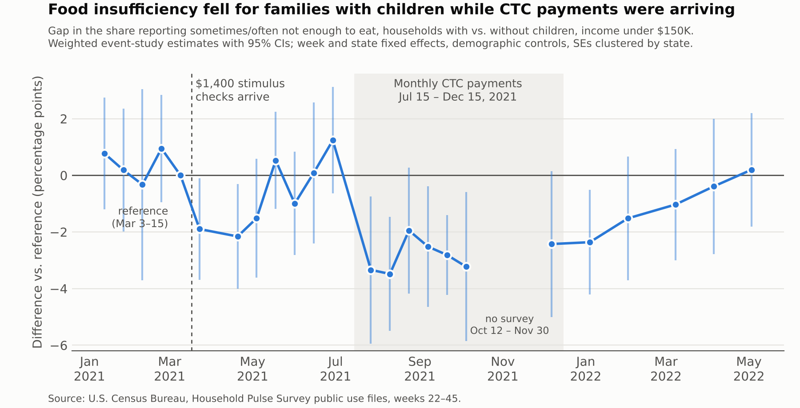
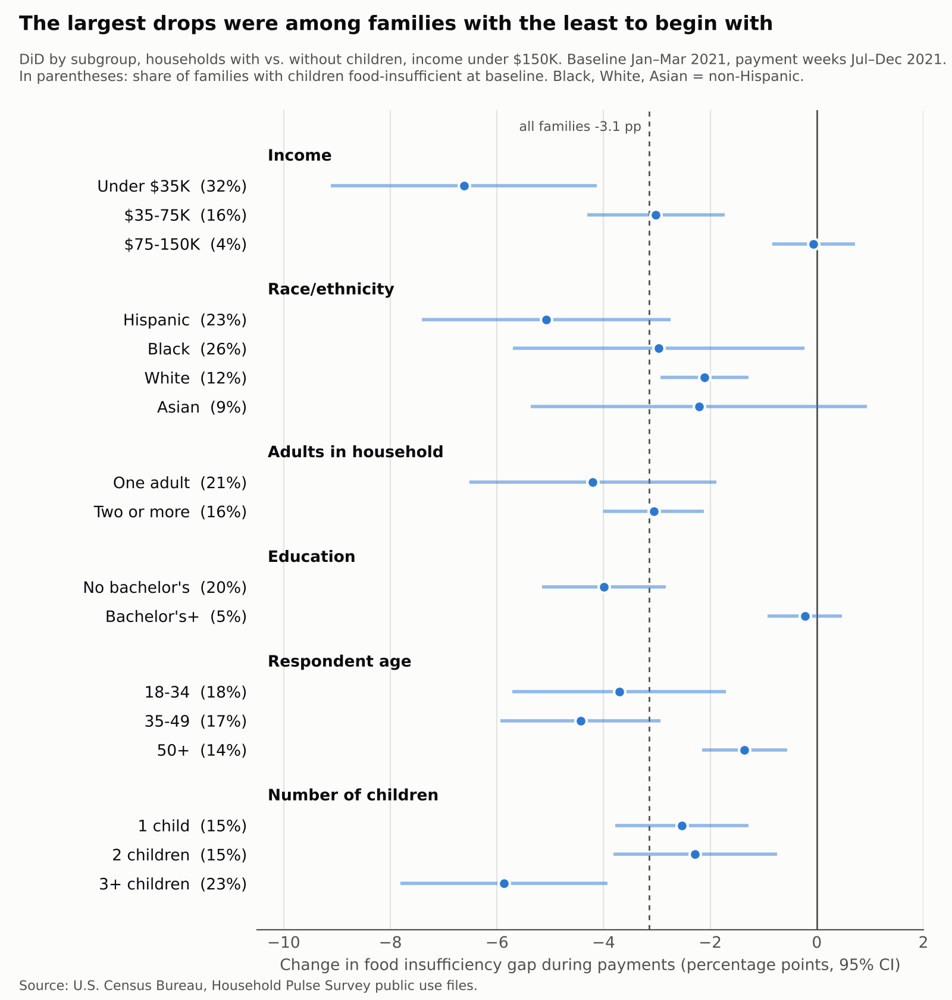

# Who benefited from the 2021 expanded Child Tax Credit?



The monthly Child Tax Credit (CTC) payments in the second half of 2021 lowered food insufficiency among families with children. The drop was largest for low-income, Hispanic and Black families, and for families with three or more children. The effect faded over the months after the payments stopped.

Policy brief (3 pages, non-technical): [brief/brief.pdf](brief/brief.pdf)

## Question

The American Rescue Plan Act made the 2021 CTC larger and fully refundable. The IRS paid half of it in advance, in six monthly payments: Jul 15, Aug 13, Sep 15, Oct 15, Nov 15 and Dec 15, 2021. Did those payments reduce food insufficiency, and which families gained most?

## Data

The data are the Census Household Pulse Survey public use files for weeks 22–45 (Jan 2021 – May 2022): 1,688,600 adult respondents in repeated cross-sections.

| Period | HPS weeks | Collection dates |
|---|---|---|
| Baseline (before the Mar 2021 stimulus) | 22–26 | Jan 6 – Mar 15, 2021 |
| After the stimulus, before the CTC | 27–33 | Mar 17 – Jul 5, 2021 |
| During CTC payments | 34–40 | Jul 21 – Oct 11 and Dec 1–13, 2021 |
| After payments ended | 41–45 | Dec 29, 2021 – May 9, 2022 |

HPS did not collect data from Oct 12 to Nov 30, 2021.

- **Outcome:** 1 if the household sometimes or often did not have enough to eat in the last 7 days (`CURFOODSUF` = 3 or 4).
- **Treated and comparison groups:** respondents in households with children vs. without children.
- **Main sample:** household income under $150K.

## Method

- **Difference-in-differences:** a weighted linear probability model (`PWEIGHT`) with week and state fixed effects. Controls are age, age², sex, race, Hispanic origin, education, marital status and household size. Standard errors are clustered by state and also computed with Census replicate weights (successive difference replication, 80 replicates).
- **Event study:** kids × week interactions.
- **Robustness checks:** a placebo start date, a triple difference (kids × income under $35K), an alternative outcome (difficulty paying usual expenses), an all-incomes sample, short windows around the first payment, and pre-trend diagnostics.
- **Heterogeneity:** subgroup DiDs, plus causal forests (`econml`), validated on a held-out half of the sample with a best-linear-predictor test and sorted-group DiDs.

## Results

**Main estimates** (change in the food insufficiency gap during payments; income under $150K, N = 761,268 respondents):

| Specification | During payments | After payments |
|---|---|---|
| Baseline Apr–Jul 2021 (wk 28–33) | −2.35 pp [−3.10, −1.60] | −0.60 pp [−1.38, 0.19] |
| Same, replicate-weight SEs | −2.35 pp [−3.15, −1.55] | −0.60 pp [−1.37, 0.18] |
| Baseline Jan–Mar 2021 (wk 22–26) | −3.13 pp [−4.00, −2.26] | −1.39 pp [−2.51, −0.26] |
| Income under $75K, baseline wk 28–33 | −3.18 pp [−4.38, −1.98] | −0.82 pp [−1.83, 0.20] |
| All incomes, baseline wk 28–33 | −1.96 pp [−2.67, −1.25] | −0.45 pp [−1.04, 0.13] |
| Week 33 vs 34 only (first payment) | −4.48 pp [−6.29, −2.67] | — |

At baseline, about 14% of families with children under $150K were food-insufficient, so a 2.4–3.1 pp drop is roughly a 17–22% reduction. Families under $35K saw an extra −4.2 pp [−7.1, −1.4] in the triple difference. The alternative outcome, difficulty paying usual household expenses, also fell (−1.1 pp, p = .04).

**Benchmarks.** Shafer et al. (2022) report −3.7 pp for the week 33 → 34 change, and the same comparison here gives −4.5 pp. Parolin et al. (2021) report about −7.5 pp for families under $35K (Apr–Aug 2021), and the same sample and window here give −7.0 pp.

**Pre-trends.** The April–July 2021 pre-period is not flat: the gap rises toward week 33, and a placebo start at week 31 gives +1.1 pp (p = .08). Extending the data back to January explains this. Over weeks 22–26 the gap is flat. It drops about 2.5 pp [−3.9, −1.1] when the $1,400-per-person stimulus checks arrive in mid-March, then drifts back up through the spring. Measured against the clean January–March baseline, the CTC effect is larger (−3.1 pp), so the main estimate is conservative. Linear-trend corrections give −4 to −8 pp, but they treat a one-time stimulus fade as a lasting trend, so I don't rely on them.

## Who benefited most



- **Plain subgroup DiDs** (Jan–Mar baseline vs. payment weeks): the largest drops were in families with income under $35K (−6.6 pp), Hispanic families (−5.1), families with three or more children (−5.9), families without a bachelor's degree (−4.0) and single-adult households (−4.2). The effects were near zero for families earning $75–150K and for college graduates. These are also the groups with the highest baseline food insufficiency.
- **Causal forest:** I fit one forest per period for the kids vs. no-kids gap, trained on a random half of the sample. On the other half, the predicted change lines up with the realized DiD: the best-linear-predictor slope is 0.85 [0.45, 1.24], significantly above 0 and consistent with 1.
- **Sorted groups:** the quartile with the largest predicted effect shows a −5.1 pp DiD [−6.7, −3.5], and the other three quartiles are close to 0. Families with children in that top quartile are 64% under $35K, 36% Hispanic, 22% Black and 9% college-educated, compared with 8% / 14% / 11% / 26% in the next quartile.
- **Income and age** are the most important splitting variables.

## Limitations

- **Comparison group:** households without children are the comparison group, and they were hit by different COVID-era shocks and policies: SNAP emergency allotments, school meal waivers, and the end of pandemic unemployment benefits in September 2021.
- **Repeated cross-sections:** the data aren't a panel. Answers are self-reported, and response rates are low (single digits).
- **Income question:** it asks about 2019 income through week 33 and 2020 income from week 34 onward, so income-restricted samples can change composition at treatment onset. The all-incomes results point the same way.
- **The unit is the adult respondent,** not the household.
- **Possible tax-time effect:** the effect lingering into early 2022 may reflect the lump-sum second half of the credit paid at tax time. That's not tested here.

## Reproduce

```bash
pip install -r requirements.txt
python src/01_download.py 22 45      # 24 zips from www2.census.gov (~1.8 GB) into data/raw/
python src/02_clean.py               # data/clean/ + variable audit
python src/03_did.py                 # main DiD, event study, placebo, robustness
python src/03b_pretrend.py           # extended event study + pre-trend checks
python src/03c_repwgt.py             # replicate-weight SEs
python src/04_heterogeneity.py       # subgroup DiDs + causal forests (~2 min)
python src/05_figures.py             # event study chart
python src/05b_subgroups_fig.py      # subgroup chart
python src/05b_subgroups_fig.py brief  # shorter version for the brief
python brief/make_brief.py           # brief/brief.pdf
```

Week dates and shared settings are in `src/config.py`. To test without downloading anything, see `tests/make_synthetic.py` (fake data; paths are set with `HPS_RAW` / `HPS_CLEAN` / `HPS_OUT`).

## References

- Parolin, Z., Ananat, E., Collyer, S., Curran, M., & Wimer, C. (2021). The Initial Effects of the Expanded Child Tax Credit on Material Hardship. NBER Working Paper 29285.
- Shafer, P. R., Gutiérrez, K. M., Ettinger de Cuba, S., Bovell-Ammon, A., & Raifman, J. (2022). Association of the Implementation of Child Tax Credit Advance Payments With Food Insufficiency in US Households. *JAMA Network Open*, 5(1), e2143296.
- Chernozhukov, V., Demirer, M., Duflo, E., & Fernández-Val, I. (2018). Generic Machine Learning Inference on Heterogeneous Treatment Effects in Randomized Experiments. NBER Working Paper 24678.
